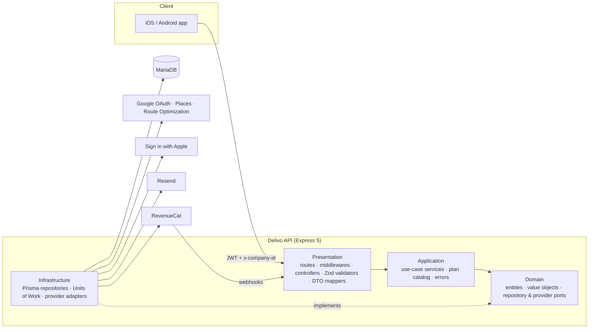

<div align="center">

# Delivo API

**The backend for a mobile app that helps small distributors in Costa Rica run their sales and deliveries: orders, optimized delivery routes, collections, and subscription plans for multiple companies.**


[Architecture](docs/architecture.md) · [API Reference](docs/api.md) · [Domain Model](docs/domain-model.md) · [Billing](docs/billing.md) · [Deployment](docs/deployment.md)

</div>

---

## Overview

Delivo is a production backend behind an iOS/Android app for route-based distributors: businesses that sell to a fixed set of clients, deliver in their own vehicles, and collect payment on delivery.

The API manages the whole cycle:

1. **Sell:** build orders from a product catalog with IVA (Costa Rican VAT) calculated per line.
2. **Plan:** group pending orders into a route and optimize the stop order with the **Google Route Optimization API**, taking live traffic into account.
3. **Deliver:** drivers work through the stops, and each order moves `PENDING → ON_ROUTE → IN_TRANSIT → DELIVERED`.
4. **Collect:** record partial payments with any payment method. An order is marked `PAID` once its balance reaches zero.
5. **Measure:** a financial summary groups income by day, week, month, quarter and year, and compares it with the previous period.

All of this runs in a **multi-tenant** model. A user can belong to several companies as `OWNER`, `ADMIN` or `DEALER` (driver), and each company has its own **subscription plan** with usage limits enforced by the API.

## Engineering highlights

| | |
|---|---|
| **Clean Architecture / DDD** | Four strict layers (domain → application → infrastructure → presentation). Entities are built from self-validating value objects, and the domain depends only on interfaces. Wiring is manual constructor injection, with no DI framework. |
| **Transactional Units of Work** | Company creation (company + owner + FREE subscription) and account deletion (a cascade through every tenant table) each run in a single Prisma transaction through a domain-level `UnitOfWork` port. |
| **Pluggable providers** | Payments (`IPaymentProvider` → RevenueCat), OAuth (`IOAuthProvider` → Google / Apple), route optimization, places and email all sit behind ports, so a vendor can be swapped without touching application code. |
| **Plan enforcement as middleware** | `enforceLimit("clients")` checks usage against the plan catalog before the handler runs, and returns **HTTP 402** with a machine-readable `PLAN_LIMIT_EXCEEDED` payload so the client can show its upgrade screen. |
| **Idempotent, verified webhooks** | RevenueCat webhooks are checked with a constant-time shared-secret comparison and applied as one idempotent upsert, so replaying an event is harmless. Events for deleted companies are acknowledged and ignored, so the provider does not keep retrying them. |
| **App-Store-grade account deletion** | Hard deletion runs in one transaction. Afterwards, best-effort side effects (Apple token revocation, RevenueCat subscriber deletion, confirmation email) run in isolation, so an outage at a provider can never roll back the deletion or surface an error to the client. |
| **Fail-fast configuration** | The server refuses to boot if required secrets are missing, the minimum frontend version is not valid semver, or the review-only login is enabled with a weak password. |
| **Timezone-correct billing windows** | Monthly and daily quotas roll over at midnight in `America/Costa_Rica`, whatever timezone the server runs in. |
| **Security details** | JWT auth, role-based member management (last-owner protection, ADMIN cannot remove OWNER), per-IP rate limiting on sensitive routes, `crypto.timingSafeEqual` for every secret comparison, and no user enumeration. |

## Architecture at a glance



For more detail, see [docs/architecture.md](docs/architecture.md).

## Tech stack

| Concern | Choice |
|---|---|
| Runtime / language | Node.js 22, TypeScript 5.9 (strict) |
| HTTP framework | Express 5 |
| Validation | Zod 4 |
| ORM / database | Prisma 7 with the `@prisma/adapter-mariadb` driver adapter on MariaDB 11 |
| Auth | JWT (`jsonwebtoken`), Google Sign-In (`google-auth-library`), Sign in with Apple (`apple-signin-auth`) |
| Maps | Google Route Optimization API, Google Places API |
| Payments | RevenueCat (in-app subscriptions) |
| Email | Resend |
| Packaging | Multi-stage Dockerfile, `docker compose` with MariaDB |

## Features

- **Auth:** Google and Apple sign-in exchanged for a 7-day JWT, token refresh, and profile management.
- **Companies and teams:** create companies, invite members by email (7-day tokens), accept or revoke invitations, and remove members with role checks.
- **Clients:** a customer directory with geolocation (lat/lng), per-company uniqueness of name, phone and email, and soft delete.
- **Products:** a catalog with gross price and IVA rate (13% by default), and soft delete.
- **Orders:** order lines priced from the catalog, the delivery status workflow, and open vs. billed views per company and per client.
- **Payments:** partial payments across configurable payment methods, with validation that the order was delivered and is not overpaid.
- **Routes:** create a route, add orders as stops, optimize the order of the stops (with polylines for the map), and complete stops one by one. The route closes itself when every stop is done.
- **Geolocation:** Google Places autocomplete limited to Costa Rica, plus place details.
- **Stats:** a financial summary for any date range, with period-over-period change.
- **Billing:** FREE / BASIC plans, per-resource quotas, a subscription status endpoint (with `percentUsed` for 80%/100% warnings), and RevenueCat sync.
- **System:** `GET /system/min-frontend-version` lets old app builds force an update before login.

## API overview

All endpoints live under `/api/v1`. Tenant-scoped endpoints read the active company from the `x-company-id` header.

| Area | Base path | Highlights |
|---|---|---|
| Auth | `/auth` | `POST /google`, `POST /apple`, `POST /refresh`, `GET /me` |
| Profile | `/me` | get/update profile, delete account |
| Companies | `/companies` | CRUD, `/:companyId/members`, `/:companyId/invitations` |
| Invitations | `/invitations` | `POST /accept` |
| Clients | `/clients` | CRUD (plan-limited) |
| Products | `/products` | CRUD (plan-limited) |
| Orders | `/orders` | create (plan-limited), items, delivery, payments, per-client views |
| Payment methods | `/payments/methods` | list / create |
| Routes | `/routes` | create (plan-limited), stops, `POST /:id/start` (optimize), complete stop |
| Stats | `/stats` | `GET /financial-summary?start=&end=` |
| Locations | `/locations` | `GET /autocomplete?q=`, `GET /place/:id` |
| Billing | `/billing` | `GET /subscription`, `POST /webhooks/revenuecat` |
| System | `/system` | `GET /min-frontend-version` |

Every endpoint, with its request body and responses, is documented in [docs/api.md](docs/api.md).

## Project structure

```
src/
├── domain/                 # Pure business model: no framework, no Prisma
│   └── {module}/           #   entities/ valueObjects/ repositories/ providers/ unitsOfWork/
├── application/            # Use cases: services (interface + implementation), errors
│   └── billing/PlanCatalog.ts
├── infrastructure/         # Adapters: Prisma repositories and mappers, external providers
│   └── prisma/             #   schema.prisma, migrations/, client.ts
├── presentation/           # Express: routes, middlewares, controllers, validators, DTOs
│   ├── app.ts
│   └── server.ts           #   entry point
├── dependencyInjection/
│   └── container.ts        # Manual composition root
└── types/express.d.ts
```

Modules: `auth`, `users`, `companies`, `clients`, `products`, `orders`, `routes`, `geolocation`, `stats`, `billing`, `system`.

## Getting started

### Prerequisites

- Node.js 22+
- Docker (for MariaDB), or a local MariaDB 11 instance

### 1. Install

```bash
git clone https://github.com/Santaval/delivo-api.git
cd delivo-api
npm install
```

### 2. Configure

```bash
cp .env.example .env
```

Fill in at least `DATABASE_URL`, `DB_HOST`, `DB_USER`, `DB_PASSWORD`, `DB_NAME`, `DB_PORT`, `JWT_SECRET`, `RESEND_API_KEY`, `MAIL_FROM`, `APP_INVITE_URL` and `MIN_FRONTEND_VERSION`. Every variable is described in [docs/configuration.md](docs/configuration.md).

### 3. Start the database and apply migrations

```bash
docker compose up -d db
npx prisma migrate deploy
npx prisma generate
```

### 4. Run

```bash
npm run dev            # nodemon + ts-node on http://localhost:3000
curl http://localhost:3000/api/v1/system/min-frontend-version
```

### Scripts

| Script | Description |
|---|---|
| `npm run dev` | Development server with hot reload |
| `npm run build` | Compile with `tsc` and rewrite `@/*` aliases with `tsc-alias` |
| `npm run start` | Run the compiled build with `tsconfig-paths` |
| `npm run start:prod` | Run the compiled build (used by the Docker image) |

## Documentation

| Document | Contents |
|---|---|
| [Architecture](docs/architecture.md) | Layers, request lifecycle, DI, Units of Work, error handling |
| [Domain model](docs/domain-model.md) | ER diagram, aggregates, state machines |
| [API reference](docs/api.md) | Every endpoint, with bodies, guards and responses |
| [Authentication and teams](docs/authentication.md) | OAuth → JWT, multi-tenancy, roles, invitations |
| [Billing and plans](docs/billing.md) | Plan catalog, quota enforcement, RevenueCat sync |
| [Route optimization](docs/route-optimization.md) | From orders to an optimized delivery route |
| [Account deletion](docs/account-deletion.md) | Transactional cascade and best-effort external cleanup |
| [Configuration](docs/configuration.md) | Environment variables and boot-time validation |
| [Deployment](docs/deployment.md) | Docker image, compose, migrations |
| [Contributing](docs/contributing.md) | Conventions for adding a new module |

## Author

**Aaron Santana**, backend and mobile developer from Costa Rica. GitHub: [@Santaval](https://github.com/Santaval)

## License

Copyright © 2025–2026 Aaron Santana. **All rights reserved.**

The source code is published so people can read and evaluate it. It may not be copied, modified, distributed or used commercially without prior written permission.
