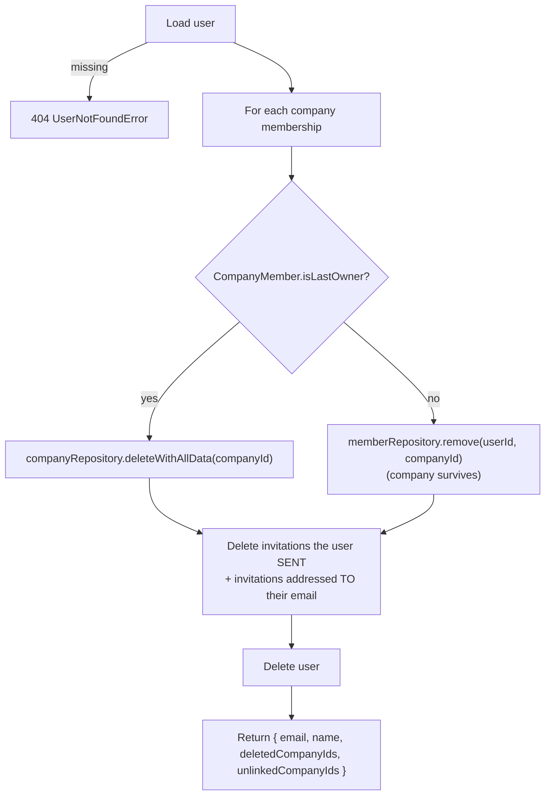

# Account deletion

Apple (App Review guideline 5.1.1(v)) and Google Play require apps that support account creation to also support **in-app account deletion**. In a multi-tenant system this is harder than deleting one row: the user may be the sole owner of a company that holds orders, routes, payments and a paid subscription, or just one member of someone else's company.

Delivo splits the job in two:

1. A **transactional core** that either deletes everything it must or nothing at all.
2. **Best-effort side effects** at external providers, which run only after the commit and can never undo it.

---

## Endpoint

```http
POST /api/v1/me
Authorization: Bearer <jwt>
Content-Type: application/json

{ "appleAuthCode": "c1a2b3..." }   // optional, sent only by the iOS client
```

- Response: **`204 No Content`**. The client then signs the user out.
- Rate limited to **5 requests per 15 minutes per IP**.
- Unknown body keys are rejected (`400`).
- The controller has no `try/catch` around the core: a `UserNotFoundError` and similar errors reach the central `errorHandler` through `asyncHandler`.

## 1. Transactional core

`AccountDeletionService` runs inside `UserDeletionUnitOfWork`, a single Prisma `$transaction`:



### Deleting a company the user solely owns

Foreign keys are `ON DELETE RESTRICT`, and `Client` and `Product` normally use **soft** delete, which read paths filter out. A company therefore can't simply be dropped. `deleteWithAllData` removes rows in an explicit **leaf-to-root topological order**, using raw `deleteMany` calls that also catch soft-deleted rows. Any row left behind would make the final `company.delete()` fail.

```
RoutePoint → ClientPayment → ClientBillItem → ClientBill → Route
SupplierBillItem → SupplierBill → Supplier
PaymentMethod → Product → Client
TaxPeriod → Subscription
CompanyInvitation → UserCompany
Company
```

### Why the invitations step exists

- **Sent invitations** reference the user through a restrictive foreign key (`invitedById`) and would block the user delete.
- **Invitations addressed to the user's email** are removed as hygiene, so a person who later signs up again with the same email doesn't inherit stale invitations.

### Why email and name are captured first

The confirmation email is sent *after* the user row no longer exists, so the recipient's address and name are read at the start of the transaction and returned in `AccountDeletionResult`.

## 2. Best-effort external cleanup (after commit)

`AccountDeletionExternalCleanup.run()` performs three independent side effects. Each has its own `try/catch`, and the controller wraps the whole call in a second guard. A provider outage is logged, is **never** surfaced to the client as a 5xx, and **never** undoes the deletion.

| # | Side effect | Details |
|---|---|---|
| 1 | **Revoke the Sign in with Apple token** | Only when the iOS client sent an authorization code. Revoked directly through Apple's `/auth/revoke` using a client secret signed with the `.p8` key. Skipped with a warning when the Apple env vars are not configured. Google needs nothing here because the server never stores Google tokens |
| 2 | **Delete the RevenueCat subscriber** | For each deleted company (`app_user_id === companyId`). Idempotent: `200`, `204` and `404` all count as success. Skipped when `REVENUECAT_API_KEY` is unset |
| 3 | **Send a confirmation email** | HTML and plain text (es-CR) through Resend, to the address captured before deletion |

## 3. Late webhook protection

A subscription can renew or expire *after* its company is gone. Without a guard, the webhook upsert would hit a missing foreign key, return `500`, and RevenueCat would retry indefinitely. `SubscriptionSyncService.applyEvent` first checks that the company exists. If it does not, the event is logged, the endpoint returns `200`, and nothing is written.

## Audit logging

Only non-identifying counters are logged:

```
[account-deletion] userId=… deletedCompanies=1 unlinkedCompanies=2
```

Emails, Apple authorization codes and tokens are never logged.
