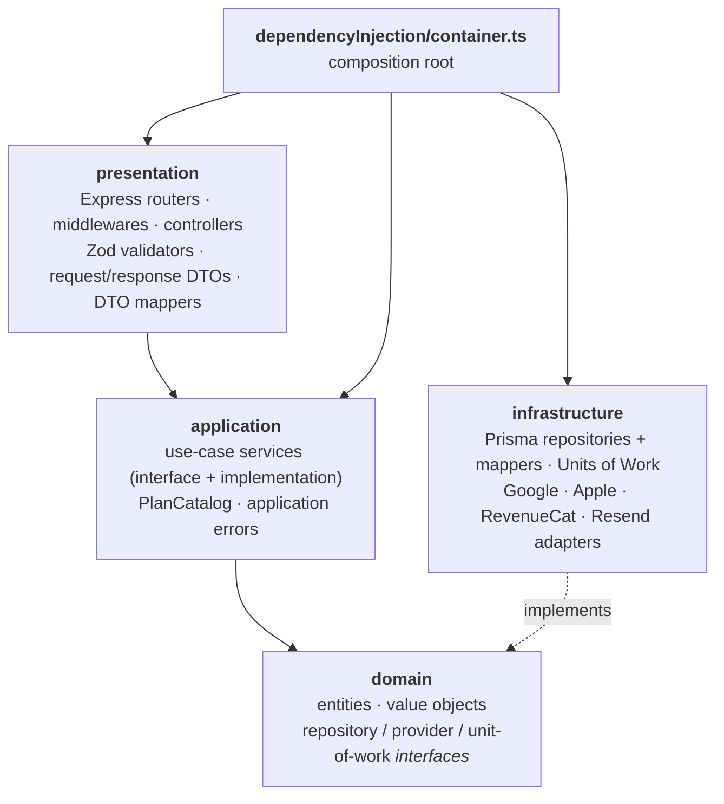
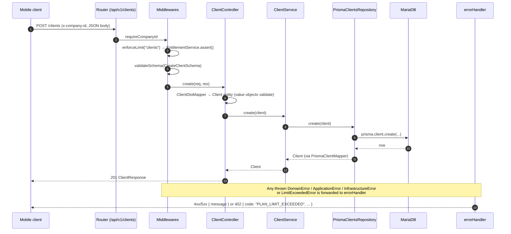
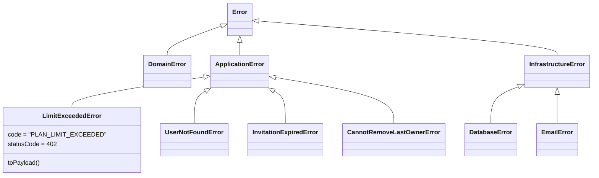

# Architecture

Delivo API follows **Clean Architecture** with **Domain-Driven Design** building blocks. Business rules live in plain TypeScript classes that know nothing about Express, Prisma or any vendor SDK. Everything else is a replaceable detail around them.

- [Layers](#layers)
- [Request lifecycle](#request-lifecycle)
- [Domain building blocks](#domain-building-blocks)
- [Composition root (manual DI)](#composition-root-manual-di)
- [Units of Work](#units-of-work)
- [Error handling](#error-handling)
- [Provider ports and adapters](#provider-ports-and-adapters)
- [Cross-cutting middleware](#cross-cutting-middleware)

---

## Layers



| Layer | Path | Responsibility | May depend on |
|---|---|---|---|
| Domain | `src/domain/{module}` | Entities, value objects, invariants, and the *ports* (interfaces) the domain needs | nothing |
| Application | `src/application/{module}` | Orchestrates use cases, enforces cross-entity rules, raises typed errors | domain |
| Infrastructure | `src/infrastructure/{module}` | Implements the ports with Prisma and third-party SDKs, and maps rows ↔ entities | domain |
| Presentation | `src/presentation/{module}` | HTTP concerns: routing, auth, validation, DTO shaping | application, domain |

Every module (`clients`, `orders`, `routes`, `billing`, …) has the same four-folder layout, so any feature can be found by walking the same path in each layer.

## Request lifecycle

Take `POST /api/v1/clients` as an example:



## Domain building blocks

### Value objects

Each primitive attribute is wrapped in a value object that validates itself when it is created. Invalid state cannot be constructed.

```ts
// src/domain/companies/valueObjects/companyRole.valueObject.ts
export class CompanyRole {
  private constructor(private readonly _value: CompanyRoleType) {}

  static create(value: string): CompanyRole {
    const validRoles: CompanyRoleType[] = ["OWNER", "ADMIN", "DEALER"];
    if (!validRoles.includes(value as CompanyRoleType)) {
      throw new DomainError(`Invalid company role: ${value}. ...`);
    }
    return new CompanyRole(value as CompanyRoleType);
  }

  canManageMembers(): boolean {
    return this._value === "OWNER" || this._value === "ADMIN";
  }
}
```

### Entities

Entities keep their state as value objects, expose read-only getters, and carry the behavior that belongs to them:

```ts
// src/domain/companies/entities/CompanyMember.ts
canRemove(target: CompanyMember): boolean {
  if (!this.canManageMembers()) return false;
  // An ADMIN cannot remove an OWNER
  if (target.isOwner() && !this.isOwner()) return false;
  return true;
}

static isLastOwner(member: CompanyMember, members: CompanyMember[]): boolean {
  if (!member.isOwner()) return false;
  return members.filter((m) => m.isOwner()).length === 1;
}
```

The same `isLastOwner` rule is used both by member removal and by [account deletion](account-deletion.md), so the invariant exists in exactly one place.

Another example is `Subscription.effectiveTier()`. It returns `FREE` for an expired or lapsed paid subscription, so the downgrade happens when the subscription is read and the stored history is never rewritten.

### Ports

The domain declares what it needs, and infrastructure provides it:

| Port | Adapter |
|---|---|
| `IClientRepository`, `IOrderRepository`, … | `Prisma*Repository` |
| `IOAuthProvider` | `GoogleOAuthProvider`, `AppleOAuthProvider` |
| `IPaymentProvider` | `RevenueCatProvider` |
| `IRouteOptimizationProvider` | `GoogleRouteOptimizationProvider` |
| `IPlacesService` | `GooglePlacesService` |
| `IEmailService` | `ResendEmailProvider` |
| `IJwtService` | `JwtTokenService` |
| `IIDGenerator` | `UuidIDGenerator` |
| `I*UnitOfWork` | `Prisma*UnitOfWork` |

## Composition root (manual DI)

`src/dependencyInjection/container.ts` builds the entire object graph by hand, in dependency order: infrastructure, then application, then presentation. There is no DI framework and no decorators, so it is always obvious what a class receives.

```ts
export const usageService: IUsageService =
  new UsageService(ordersRepository, routesRepository, clientsRepository, productsRepository, companyMemberRepository);
export const entitlementService: IEntitlementService =
  new EntitlementService(subscriptionRepository, usageService);
```

Application services never read `process.env`. Configuration such as the test-login credentials or the invite URL is injected from the validated `ENV` object at this single point.

## Units of Work

When a use case has to change several aggregates atomically, the domain defines a Unit of Work interface that hands out repositories bound to a single transaction:

```ts
// infrastructure/companies/unitsOfWork/PrismaCompanyCreationUnitOfWork.ts
async runInTransaction<T>(work: (ctx: ICompanyCreationContext) => Promise<T>): Promise<T> {
  return this.prisma.$transaction(async (tx) => {
    const context = {
      getCompanyRepository:      () => new PrismaCompaniesRepository(tx),
      getSubscriptionRepository: () => new PrismaSubscriptionRepository(tx),
    };
    return work(context);
  });
}
```

| Unit of Work | Guarantees |
|---|---|
| `CompanyCreationUnitOfWork` | A company, its OWNER membership and its FREE subscription are created together, or none of them are |
| `UserDeletionUnitOfWork` | Owned companies are cascaded, memberships unlinked, invitations removed and the user deleted in one transaction |
| `ProductDeletionUnitOfWork` | The product existence check and its soft delete run in one transaction, with product and order repositories bound to it |

The application service only sees the interface, and Prisma's `$transaction` stays inside infrastructure.

## Error handling

Each layer has its own base error that carries an HTTP `statusCode`:



Controllers are wrapped in `asyncHandler`, so a rejected promise is forwarded to the single `errorHandler` middleware:

| Error | Response |
|---|---|
| `LimitExceededError` | `402` + `{ code, resource, limit, used, tier, upgradeTo }` |
| `DomainError` / `ApplicationError` / `InfrastructureError` | `err.statusCode` + `{ message }` |
| anything else | `500 { message: "Internal Server Error" }`, with no leaked internals |

Application errors use precise status codes: `404` (not found), `403` (not allowed to manage members), `409` (already a member, invitation already exists, last owner), `410` (invitation expired), and `401` (invalid credentials).

## Provider ports and adapters

Adapters convert vendor payloads into neutral domain types at the boundary. For example, `RevenueCatProvider.parseWebhookEvent` maps `INITIAL_PURCHASE | RENEWAL | PRODUCT_CHANGE | UNCANCELLATION` to a neutral `ACTIVATED` event, and `SubscriptionSyncService` only ever deals with that neutral `SubscriptionEvent`. A second provider (the enum already reserves a slot for Tilopay) would need a new adapter plus one line in the container.

## Cross-cutting middleware

| Middleware | Purpose |
|---|---|
| `jwtAuth` | Verifies `Authorization: Bearer <jwt>` and sets `req.user = { id, email }` |
| `requireCompanyId` | Rejects the request with `400` unless an `x-company-id` header is present |
| `requireCompanyRole` | Loads the caller's membership in `:companyId` and requires `OWNER` or `ADMIN` |
| `enforceLimit(resource, opts?)` | Checks plan quotas before a create. Accepts a custom company resolver and a `when` predicate |
| `validateSchema(zodSchema)` | Validates the body and returns `400 { message }` with the first issue |
| `rateLimit({ windowMs, max })` | In-memory fixed-window limiter per IP, used on sensitive endpoints |
| `asyncHandler` | Forwards async controller errors to `errorHandler` |
