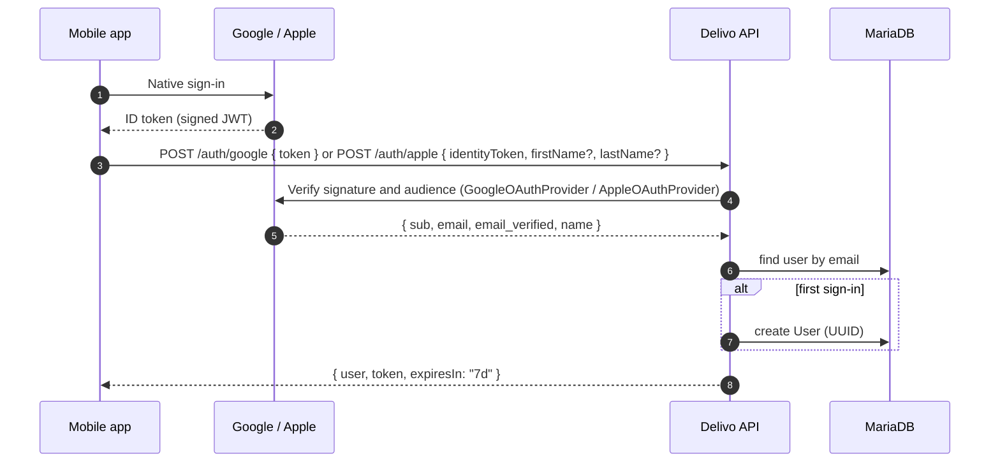
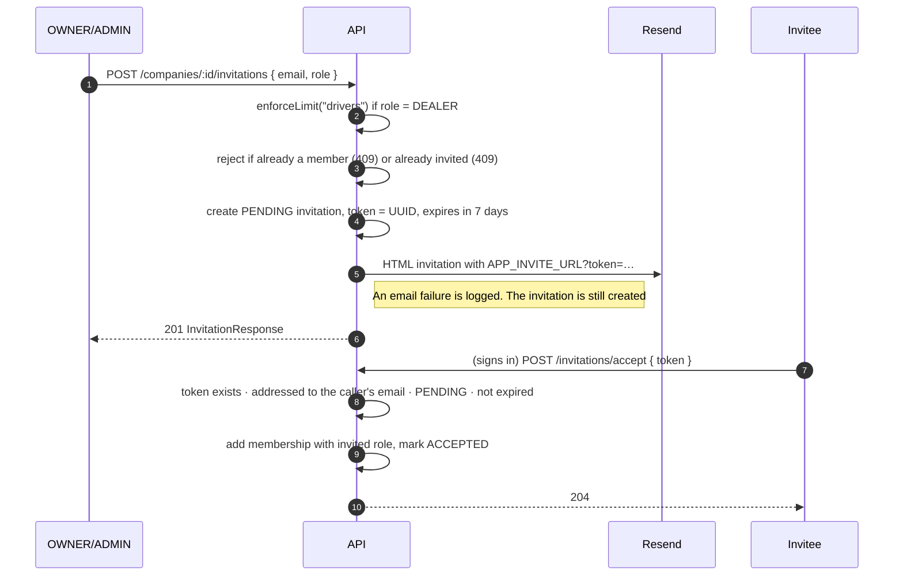

# Authentication, multi-tenancy and teams

- [Sign-in flow](#sign-in-flow)
- [JWT sessions](#jwt-sessions)
- [Multi-tenancy](#multi-tenancy)
- [Roles and permissions](#roles-and-permissions)
- [Invitations](#invitations)
- [Review-only QA login](#review-only-qa-login)

---

## Sign-in flow

The API stores **no passwords**. Identity is delegated to Google and Apple: the mobile SDK gets an ID token, and the API verifies it with the provider and issues its own JWT.



| Provider | Verification | Notes |
|---|---|---|
| Google | `google-auth-library` `verifyIdToken`, with the iOS and Android client IDs as allowed audiences | Rejects tokens whose email is not verified |
| Apple | `apple-signin-auth` `verifyIdToken`, with audience `APPLE_CLIENT_ID` | Apple only sends the user's name on the first authorization, so the client forwards `firstName`/`lastName` |

Both adapters implement the same `IOAuthProvider` port (`getUserInfo`, `revokeToken`), so `OAuthService` handles both providers with the same code.

## JWT sessions

- Signed with `JWT_SECRET`. Expiry comes from `JWT_EXPIRES_IN` (default `7d`). Payload: `{ id, email }`.
- `jwtAuth` reads `Authorization: Bearer <token>`, verifies it, and sets `req.user`.
- `POST /auth/refresh` exchanges a still-valid token for a fresh one.
- `POST /auth/logout` is stateless: the client discards the token.

## Multi-tenancy

One user can belong to several companies, for example a driver who works for two distributors. The **active company** is sent on every tenant-scoped request:

```http
GET /api/v1/clients
Authorization: Bearer eyJ...
x-company-id: 3f1c9a0e-7c1b-4a53-9d0f-1b2c3d4e5f60
```

`requireCompanyId` rejects the request with `400` when the header is missing. `CompanyIdParser` is the single place the header is read, and it is reused by controllers and by `enforceLimit`. Every repository query for tenant data filters on `companyId`.

## Roles and permissions

Roles are stored on the membership (`UserCompany.role`), not on the user, so the same person can be `OWNER` in one company and `DEALER` in another.

| Capability | OWNER | ADMIN | DEALER |
|---|:-:|:-:|:-:|
| Use sales, route and delivery features | ✅ | ✅ | ✅ |
| List members | ✅ | ✅ | ✅ |
| List, create and revoke invitations | ✅ | ✅ | — |
| Invite as ADMIN or DEALER | ✅ | ✅ | — |
| Remove an ADMIN or DEALER | ✅ | ✅ | — |
| Remove an OWNER | ✅ | — | — |
| Be invited as OWNER | — (never through an invitation) | | |

Invariants enforced in the domain (`CompanyMember`):

- `canManageMembers()`: OWNER or ADMIN.
- `canRemove(target)`: an ADMIN can never remove an OWNER.
- `isLastOwner(member, members)`: the last OWNER cannot be removed (`409`). The same rule decides whether [account deletion](account-deletion.md) deletes a company or only unlinks the user from it.

Checks are layered. The `requireCompanyRole` middleware rejects callers early with `403`, and `CompanyMemberService` checks again, so the rule still holds if the service is called from somewhere else.

## Invitations



- Emails are normalized (trimmed and lowercased) before comparison.
- An invitation can only be accepted by the account whose email it was sent to.
- Expired invitations return `410 Gone`. Revoked or accepted ones return `404`.
- Only **DEALER** invitations use up the plan's `drivers` seat. ADMIN invitations are free (`enforceLimit(..., { when: req => req.body.role === "DEALER" })`).

## Review-only QA login

App Store and Google Play reviewers need a working demo account, but this app only offers OAuth sign-in. `POST /auth/qa` is a temporary fixed-credential login, built so that it is safe when disabled and difficult to abuse when enabled:

| Safeguard | Implementation |
|---|---|
| Off by default | The route is only **registered** when `TEST_LOGIN_ENABLED=true`. When it is off, the path returns 404 instead of rejecting |
| Fails at boot | With the flag on, the server refuses to start unless `TEST_LOGIN_EMAIL` is set and `TEST_LOGIN_PASSWORD` is at least 16 characters. A warning banner is printed on every boot |
| Credentials only in env vars | No password column exists. Credentials live only in environment variables |
| Constant-time comparison | Email and password are both compared with `crypto.timingSafeEqual` **before** branching, so response timing doesn't reveal which one was wrong |
| No enumeration | Every failure returns the same `401 Credenciales inválidas` |
| Rate limited | 10 attempts per 15 minutes per IP |
| Audited | Each successful login logs the source IP (never the credentials) |
| No special privileges | The account is an ordinary FREE-plan user. On the first login it is seeded with a demo company, clients, products and orders so reviewers see a populated app |
| Defense in depth | `TestLoginService` re-checks that the feature is enabled, in case it is ever wired up somewhere else |
