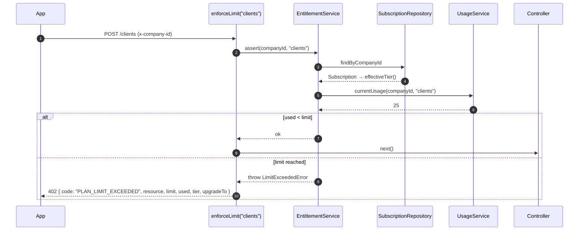
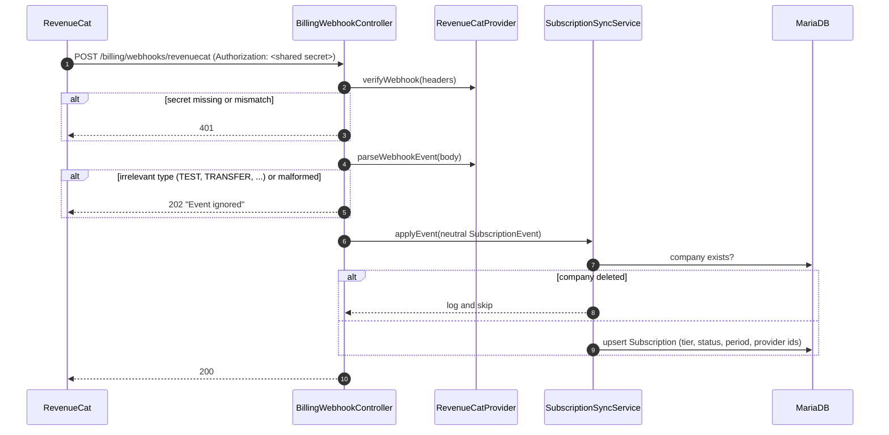

# Billing and plan enforcement

Plans belong to a **company**, not to a user. Subscriptions are bought in the mobile app through the App Store / Google Play, and **RevenueCat** keeps the API in sync with webhooks.

- [Plan catalog](#plan-catalog)
- [How usage is measured](#how-usage-is-measured)
- [Enforcement flow](#enforcement-flow)
- [Subscription status endpoint](#subscription-status-endpoint)
- [RevenueCat synchronization](#revenuecat-synchronization)
- [Subscription lifecycle](#subscription-lifecycle)
- [Adding another payment provider](#adding-another-payment-provider)

---

## Plan catalog

Limits are defined **in code** in [`src/application/billing/PlanCatalog.ts`](../src/application/billing/PlanCatalog.ts), not in the database, so a pricing change goes through code review like any other change.

| Resource | Window | FREE | BASIC ("Arranque") |
|---|---|---:|---:|
| `documents`: orders issued | calendar month | 10 | 10,000 |
| `routes`: optimized routes created | calendar day | 1 | unlimited |
| `clients`: active clients | total | 25 | unlimited |
| `products`: active products | total | 20 | unlimited |
| `drivers`: members with role `DEALER` | total | 1 | 1 |

`null` in the catalog means unlimited. `upgradeTargetFor(tier)` tells the client which plan to offer next (`FREE → BASIC`, `BASIC → null`).

## How usage is measured

`UsageService` computes usage **when it is needed**, from the existing tables. There is no counter table to keep in sync or to backfill:

| Resource | Query |
|---|---|
| documents | `ClientBill` rows with `issueDate` in the current month |
| routes | `Route` rows with `createdAt` today |
| clients / products | rows with `deletedAt IS NULL` |
| drivers | `UserCompany` rows with `role = DEALER` |

**Timezone:** monthly and daily windows are computed in `America/Costa_Rica` (a fixed UTC−6 offset with no DST) by [`billingWindows.ts`](../src/application/billing/utils/billingWindows.ts). A company's day therefore rolls over at local midnight, whatever the server's timezone. The ranges are half-open: `[start, end)`.

> Deliberate trade-off: at larger scale the intended step is an incrementally maintained `UsageCounter(companyId, period, resource)` table. This is documented in the code as known tech debt rather than built in advance.

## Enforcement flow



Design principles:

- **The API never fails silently.** A blocked action always returns a structured `402` that the app turns into an upgrade screen. The client also owns the 80% and 100% warnings, driven by `percentUsed`.
- **Checks happen only when something is created.** Existing data is never blocked. A downgraded company keeps all its clients and products and just cannot add more.
- **Each resource is counted once.** A route counts against the quota when it is created, not when it is started or re-optimized.
- **The middleware is configurable.** `enforceLimit(resource, { companyId, when })` supports routes where the company comes from a URL parameter, and conditional checks such as "only DEALER invitations use a driver seat".

## Subscription status endpoint

`GET /billing/subscription` (JWT + `x-company-id`) returns the effective tier, the stored status, and usage for every limited resource:

```json
{
  "tier": "FREE",
  "status": "ACTIVE",
  "currentPeriodEnd": null,
  "limits": [
    { "resource": "documents", "limit": 10, "used": 8, "remaining": 2, "percentUsed": 80 }
  ]
}
```

`tier` is the **effective** tier, which is what is actually enforced. `status` is the **stored** status and explains *why* a paid tier may have dropped to FREE (for example `EXPIRED`).

## RevenueCat synchronization

**Identity convention:** RevenueCat's `app_user_id` **is the `companyId`**. The mobile client logs in to RevenueCat with the active company's ID before starting a purchase, so every event maps directly to a tenant with no lookup table.



| Concern | How it is handled |
|---|---|
| **Authenticity** | Shared secret (`REVENUECAT_WEBHOOK_AUTH`) compared with `crypto.timingSafeEqual`, accepted with or without a `Bearer ` prefix |
| **Fail closed** | When the secret is not configured, *every* webhook is rejected (with a one-time warning) |
| **Robust parsing** | Unknown event types and malformed payloads map to `null` and are acknowledged with `202`, so one bad payload cannot break the endpoint or cause endless retries |
| **Idempotency** | The full target state is derived from the event and written with one upsert keyed by company, so replaying an event rewrites the same row |
| **Orphan protection** | Events for companies that no longer exist are acknowledged and ignored instead of failing on a foreign key and triggering endless retries |
| **Event mapping** | `INITIAL_PURCHASE`, `RENEWAL`, `PRODUCT_CHANGE`, `UNCANCELLATION` → `ACTIVE` · `CANCELLATION` → `CANCELLED` · `EXPIRATION` → `EXPIRED` · `BILLING_ISSUE` → `IN_GRACE_PERIOD` |

## Subscription lifecycle

- **Creation:** every company gets a `FREE / ACTIVE` subscription in the **same transaction** that creates the company (`CompanyCreationUnitOfWork`). Companies that existed before billing were backfilled by a data migration (`20260725130000_backfill_free_subscriptions`).
- **Downgrade when read:** on `EXPIRED`, the stored tier stays `BASIC`. `Subscription.effectiveTier()` returns `FREE` once the subscription is expired or `currentPeriodEnd` has passed, so plan history is kept while enforcement stays correct. A `CANCELLED` subscription keeps its paid access until the paid period ends.
- **Deletion:** when a company is deleted as part of [account deletion](account-deletion.md), its subscription row is deleted in the same transaction and the RevenueCat subscriber is removed afterwards on a best-effort basis.

## Adding another payment provider

`IPaymentProvider` (`src/domain/billing/providers/`) is the only contract the application layer depends on:

```ts
interface IPaymentProvider {
  readonly name: PaymentProviderType;
  verifyWebhook(headers): boolean;
  parseWebhookEvent(payload: unknown): SubscriptionEvent | null;
  deleteSubscriber(providerCustomerId: string): Promise<void>;
}
```

Adding a provider (the `PaymentProvider` enum already reserves Tilopay) means writing a new adapter in `src/infrastructure/billing/providers/`, adding a webhook route, and wiring it in `container.ts`. `SubscriptionSyncService`, `EntitlementService` and `enforceLimit` stay unchanged.
