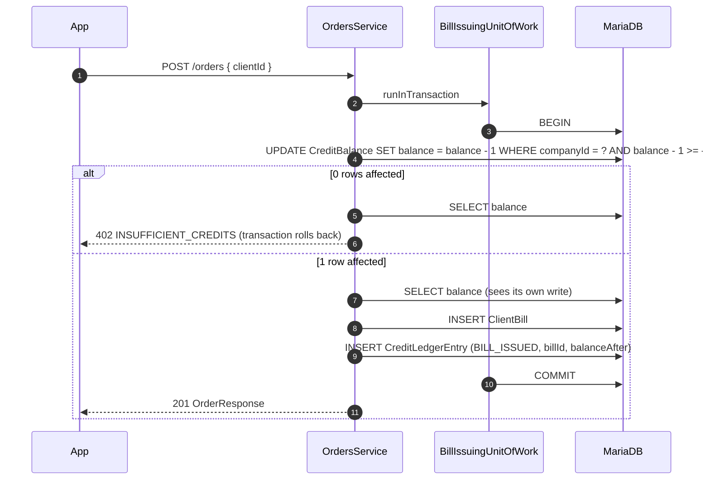
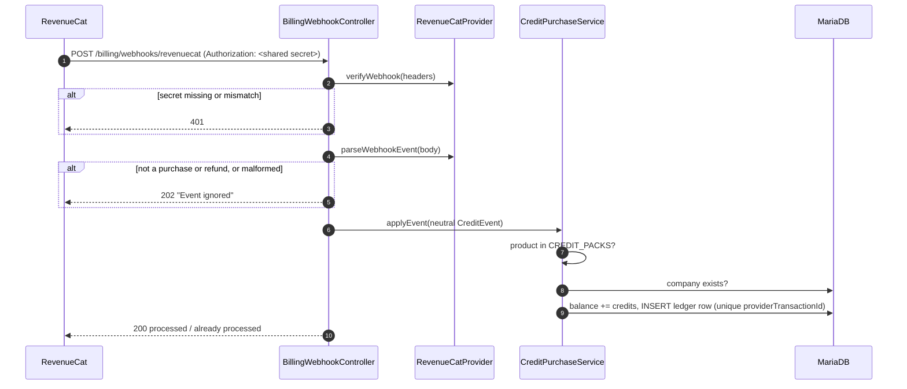

# Billing and credits

Delivo charges **per bill**. Every `ClientBill` a company issues costs **1 credit**. Credits belong to a **company**, not to a user, they never expire, and they are bought in the mobile app as consumable packs through the App Store / Google Play. **RevenueCat** reports purchases and refunds to the API with webhooks.

- [The model](#the-model)
- [Ledger and cached balance](#ledger-and-cached-balance)
- [Consuming a credit](#consuming-a-credit)
- [Overdraft floor and the 402 payload](#overdraft-floor-and-the-402-payload)
- [RevenueCat webhook](#revenuecat-webhook)
- [Credits and admin endpoints](#credits-and-admin-endpoints)
- [Adding a credit pack](#adding-a-credit-pack)
- [Adding another payment provider](#adding-another-payment-provider)
- [Account deletion](#account-deletion)

---

## The model

All numbers live **in code** in [`src/application/credits/CreditPolicy.ts`](../src/application/credits/CreditPolicy.ts), not in the database, so a pricing change goes through code review like any other change.

| Constant | Value | Meaning |
|---|---:|---|
| `WELCOME_CREDITS` | 50 | Granted to every new company, in the same transaction that creates it |
| `CREDITS_PER_BILL` | 1 | Cost of one issued bill |
| `OVERDRAFT_FLOOR` | -5 | Lowest balance a bill may leave behind |
| `LOW_BALANCE_THRESHOLD` | 10 | The app warns the company at this balance or below |
| `CREDIT_PACKS` | `delivo_bills_100` → 100 | Store product id → credits granted |

Nothing else is limited: clients, products, routes and drivers (`DEALER` members) are unlimited.

Companies that existed before credits were introduced received the 50 welcome credits through a data migration (`..._backfill_welcome_credits`).

## Ledger and cached balance

Two tables hold the state:

| Table | Role |
|---|---|
| `CreditLedgerEntry` | Append-only history. One row per change: `delta`, `reason` (`WELCOME_GRANT`, `PURCHASE`, `BILL_ISSUED`, `REFUND`, `ADMIN_ADJUSTMENT`), `balanceAfter`, and optionally `billId`, `providerTransactionId`, `productId`, `environment`, `note` |
| `CreditBalance` | One row per company with the current `balance`. It is a **cache** of the ledger sum, kept in the same transaction as every ledger row, so reading the balance never has to sum the history |

Rows are never updated or deleted (except when the company itself is deleted). Corrections are new rows, for example an `ADMIN_ADJUSTMENT`. Each row stores `balanceAfter`, so the ledger can be audited without replaying it.

## Consuming a credit

`POST /orders` runs `OrdersService.create` inside a single transaction (`IBillIssuingUnitOfWork`, Prisma implementation). The debit goes **first**, so a company without credits never creates a bill and never burns a `ClientBill.number`.



Why a conditional `UPDATE` and not a pre-check middleware:

- **A check followed by a write races.** Two concurrent `POST /orders` for a company with 1 credit left would both read "balance is fine", and both would issue a bill. The `WHERE balance - 1 >= floor` condition is evaluated by the database while it holds the row lock, so the check and the debit are one atomic step.
- **The row lock serializes bills per company.** The second request waits for the first transaction to commit and then evaluates the condition against the new balance.
- **Atomicity with the bill.** If the `ClientBill` insert fails, the debit rolls back with it, and the ledger can never disagree with the bills that exist.

## Overdraft floor and the 402 payload

A bill is allowed while `balance - 1 >= -5`. The small overdraft means a company is not blocked mid-day by a purchase that has not synced yet. At `-5` the next bill fails with `402`:

```json
{
  "code": "INSUFFICIENT_CREDITS",
  "balance": -5,
  "overdraftFloor": -5,
  "required": 1
}
```

`InsufficientCreditsError` (application layer) carries these fields and `errorHandler` turns it into the response with `toPayload()`. The API never blocks silently: the app uses the payload to show the buy-credits screen. Existing data is never blocked, only issuing new bills.

Refunds and admin adjustments **skip the floor check**, so they can push the balance lower than `-5`. Bills then stay blocked until the company buys credits again.

## RevenueCat webhook

**Identity convention:** RevenueCat's `app_user_id` **is the `companyId`**. The mobile client logs in to RevenueCat with the active company's ID before starting a purchase, so every event maps to a tenant with no lookup table. Consumable packs have no transfer problem: a grant is written to our ledger once, keyed by the store transaction id, so a later restore, transfer or alias on the provider side cannot move it.



### Event mapping

| RevenueCat event | Neutral event | Ledger row |
|---|---|---|
| `NON_RENEWING_PURCHASE` | `PURCHASE` | `PURCHASE`, `+credits`, `providerTransactionId = <transaction_id>` |
| `CANCELLATION` with `cancel_reason = CUSTOMER_SUPPORT` (store refund) | `REFUND` | `REFUND`, `-credits`, `providerTransactionId = refund:<transaction_id>` |
| Anything else (`TEST`, `TRANSFER`, other cancel reasons, subscription events) | none | none, answered `202` |

### Handling rules

| Concern | How it is handled |
|---|---|
| **Authenticity** | Shared secret (`REVENUECAT_WEBHOOK_AUTH`) compared with `crypto.timingSafeEqual`, accepted with or without a `Bearer ` prefix |
| **Fail closed** | When the secret is not configured, *every* webhook is rejected (with a one-time warning) |
| **Robust parsing** | Unknown event types and malformed payloads map to `null` and are acknowledged with `202`, so one bad payload cannot break the endpoint or cause endless retries |
| **Idempotency** | `CreditLedgerEntry.providerTransactionId` is unique. A replayed event hits the constraint (`P2002`), the transaction rolls back (so the balance increment is undone) and the service answers `200 "Event already processed"`. This also holds for concurrent deliveries of the same event |
| **Refund prefix** | A refund refers to the same store transaction as the purchase, so its key is `refund:<transaction_id>`. That keeps both rows unique while still making refund replays idempotent |
| **Unknown product** | A product id that is not in `CREDIT_PACKS` is logged and answered `202`, so a new store product cannot cause retries before the code knows it |
| **Orphan protection** | Events for companies that no longer exist are acknowledged and ignored instead of failing on a foreign key and triggering endless retries |
| **Sandbox** | See [Sandbox events](#sandbox-events). Gated by `BILLING_ACCEPT_SANDBOX` |
| **Refund attribution** | See [Refund attribution](#refund-attribution) |

Responses: `200` processed or duplicate, `202` ignored, unknown product or sandbox event ignored, `401` bad secret.

### Sandbox events

Events carry an `environment` (`SANDBOX` or `PRODUCTION`). The `BILLING_ACCEPT_SANDBOX` setting (`true` enables, anything else or unset disables) decides what happens to sandbox ones:

| Deployment | `BILLING_ACCEPT_SANDBOX` | Sandbox event |
|---|---|---|
| Production | `false` (default) | Logged, answered `202`, ledger untouched (outcome `SANDBOX_IGNORED`) |
| Dev / staging | `true` | Granted like a real one; the row stores `environment = SANDBOX` |

Events without an environment are treated as production. The check runs first in `applyEvent`, before the product and company lookups, so an ignored sandbox event costs no database access. Configure RevenueCat with one webhook per environment: the production API's webhook should receive production events only, and a sandbox-only webhook should point at the dev API, so the gate is a second line of defence rather than the only one.

### Refund attribution

A refund is booked on the company that received the original purchase, not on the company named in the refund event. The service looks up the ledger row stored under the purchase's `transaction_id` and uses its `companyId`; when that row does not exist it falls back to the event's `app_user_id`. A log line is written when the two differ. The idempotency key stays `refund:<transaction_id>`.

This matters because RevenueCat can move a purchase to another app user (a restore, or the "Transfer to new App User ID" behaviour in the project's restore settings), so the refund event may name a different company than the one that was credited. Without this lookup the wrong tenant would be debited.

## Credits and admin endpoints

Full request and response shapes are in [api.md](api.md#credits).

| Endpoint | Auth | Purpose |
|---|---|---|
| `GET /billing/credits` | JWT, `x-company-id`, any member role | Balance, `overdraftFloor`, `lowBalanceThreshold` and the `packs` list |
| `GET /billing/credits/ledger` | JWT, `x-company-id`, any member role | Paginated ledger, newest first, with the bill number for `BILL_ISSUED` rows |
| `POST /admin/companies/:companyId/credits` | `x-admin-key` | Manual adjustment `{ delta, note }` (writes an `ADMIN_ADJUSTMENT` row, no floor check) |
| `GET /admin/companies/:companyId/credits` | `x-admin-key` | Balance and the full ledger of a company, for support |

There is no platform-admin role. The `/admin` routes are guarded by the shared `ADMIN_API_KEY` environment variable (hashed with SHA-256 and compared with `timingSafeEqual`), answer `401` when the key is unset, and are rate limited to 10 requests per 15 minutes per IP. See [configuration.md](configuration.md).

## Adding a credit pack

1. Create the consumable product in App Store Connect / Google Play and attach it to the RevenueCat offering.
2. Add the product id to `CREDIT_PACKS` in [`CreditPolicy.ts`](../src/application/credits/CreditPolicy.ts), for example `delivo_bills_500: 500`.
3. Deploy **before** the app version that sells it. Until then purchases of the product are answered `202` and no credits are granted.

Prices come from the store, never from the API. `GET /billing/credits` returns the pack list so the app can match store packages to credit amounts. Changing the credits of an existing product only affects future purchases; refunds use the current value, so avoid changing a pack that has purchases that could still be refunded.

## Adding another payment provider

`IPaymentProvider` (`src/domain/billing/providers/`) is the only contract the application layer depends on:

```ts
interface IPaymentProvider {
  readonly name: PaymentProviderType;
  verifyWebhook(headers): boolean;
  parseWebhookEvent(payload: unknown): CreditEvent | null;
  deleteSubscriber(providerCustomerId: string): Promise<void>;
}
```

Adding a provider (for example Tilopay; add it to `PAYMENT_PROVIDERS`) means writing a new adapter in `src/infrastructure/billing/providers/`, adding a webhook route, and wiring it in `container.ts`. `CreditPurchaseService` and the ledger stay unchanged. The adapter must keep the `app_user_id = companyId` convention and use the store transaction id as `transactionId`.

## Account deletion

When a company is deleted as part of [account deletion](account-deletion.md), its `CreditBalance` and `CreditLedgerEntry` rows are deleted in the same transaction, and the RevenueCat subscriber is removed afterwards on a best-effort basis. A late webhook for the deleted company is acknowledged and ignored.
