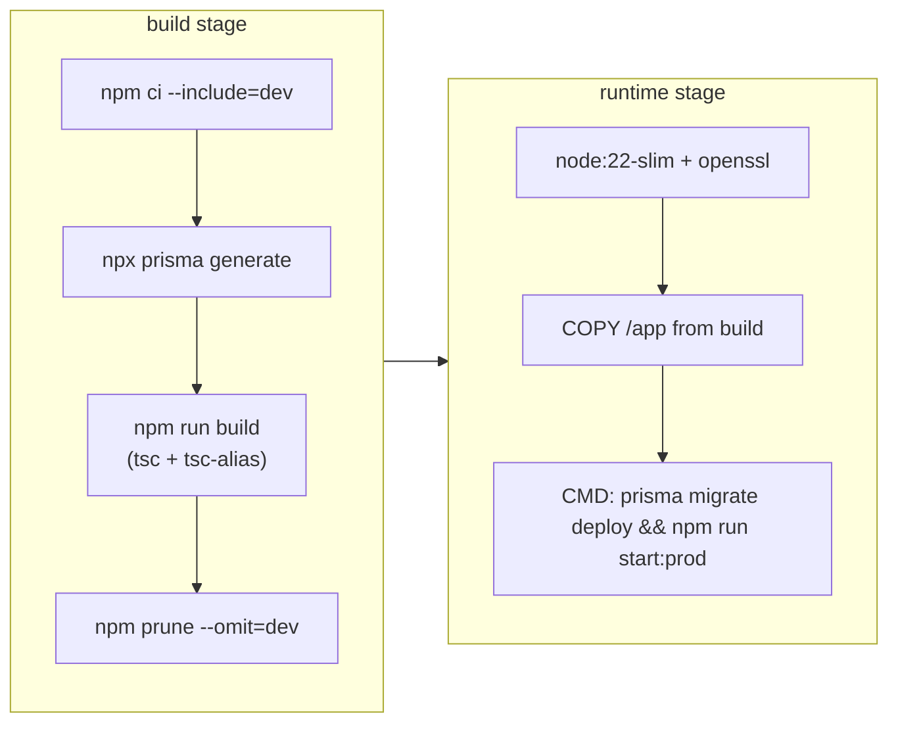

# Deployment

The API ships as a single Docker image that applies pending database migrations every time it starts.

## Docker image

[`Dockerfile`](../Dockerfile) is a multi-stage build on `node:22-slim`:



- **Small runtime image:** build tooling (`build-essential`, `node-gyp`, `python`) stays in the discarded build stage, and dev dependencies are pruned.
- **Migrations on boot:** `prisma migrate deploy` applies only committed migrations and never generates new ones, so it is safe to run on every start.
- **Path aliases resolved at build time:** `tsc-alias` rewrites `@/…` imports into relative paths, so production runs plain `node dist/presentation/server.js` without `tsconfig-paths`.
- The image exposes port **3000** and carries the `fly_launch_runtime` label, so it deploys to Fly.io as-is. It also runs unchanged on any container platform.

```bash
docker build -t delivo-api .
docker run --env-file .env -p 3000:3000 delivo-api
```

## docker compose

[`docker-compose.yml`](../docker-compose.yml) runs the API together with **MariaDB 11**:

| Service | Image | Notes |
|---|---|---|
| `api` | built from the Dockerfile | Restart policy `unless-stopped`, depends on `db` |
| `db` | `mariadb:11` | Persistent `db-data` volume, InnoDB health check |

```bash
docker compose up -d          # full stack
docker compose up -d db       # database only, for local development with npm run dev
```

## Prisma layout

Prisma files live inside the infrastructure layer rather than at the repository root. [`prisma.config.ts`](../prisma.config.ts) points the CLI at them:

| Item | Path |
|---|---|
| Schema | `src/infrastructure/prisma/schema.prisma` |
| Migrations | `src/infrastructure/prisma/migrations/` |
| Generated client | `src/infrastructure/prisma/generated/` (git-ignored, regenerated in the build) |
| Runtime client | `src/infrastructure/prisma/client.ts` (Prisma 7 + `PrismaMariaDb` driver adapter) |

## Release checklist

1. `npx prisma migrate dev --name <change>` locally, then commit the migration folder.
2. Set or rotate any new environment variables on the host (see [configuration.md](configuration.md)).
3. Deploy the image. Migrations apply automatically on start.
4. If the release needs a new app build, raise `MIN_FRONTEND_VERSION` **after** the new build is live in the stores.
5. Make sure `TEST_LOGIN_ENABLED` is `false` unless a store review is in progress.
