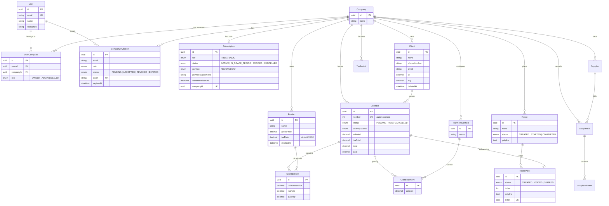
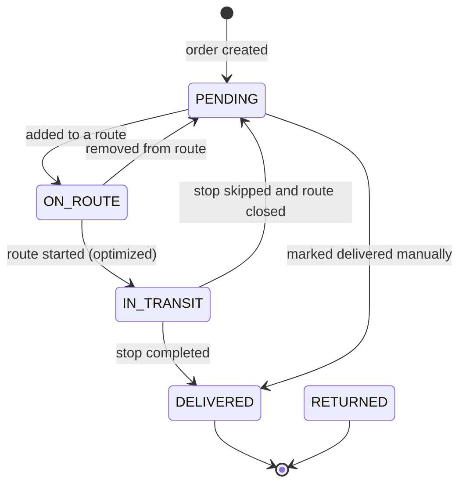
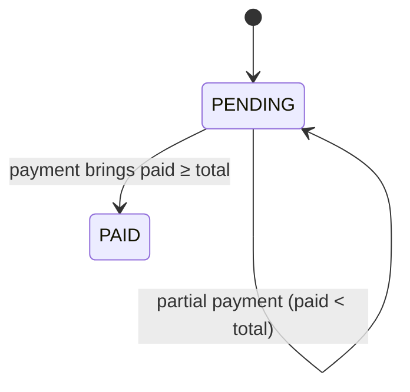
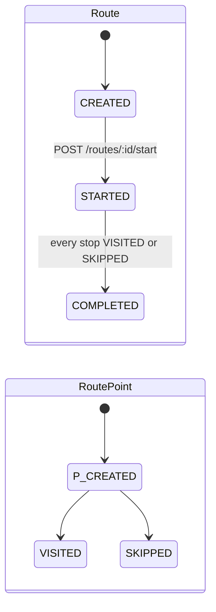

# Domain model

The schema lives in [`src/infrastructure/prisma/schema.prisma`](../src/infrastructure/prisma/schema.prisma) and has evolved through 20 versioned Prisma migrations. Every business table is scoped to a `Company`, which is the tenant boundary.

- [Entity-relationship diagram](#entity-relationship-diagram)
- [Aggregates](#aggregates)
- [State machines](#state-machines)
- [Data integrity rules](#data-integrity-rules)

---

## Entity-relationship diagram

> `Supplier`, `SupplierBill`, `SupplierBillItem` and `TaxPeriod` model purchases and the monthly IVA declaration (IVA collected − deductible IVA = IVA payable). They are part of the schema, and their domain and application layers exist, ahead of the upcoming tax-reporting features.

## Aggregates

| Aggregate | Root | Notes |
|---|---|---|
| **Identity** | `User` | Created on the first Google/Apple sign-in. Has no password column: authentication is delegated to the identity providers. |
| **Company** | `Company` | The tenant. Memberships (`UserCompany`) carry a role, and invitations carry a single-use token and a 7-day expiry. |
| **Subscription** | `Subscription` | One per company (`companyId` is unique). Created as FREE in the same transaction as the company. |
| **Client** | `Client` | Optional geolocation used as the delivery destination. Name, phone and email are each unique per company. |
| **Product** | `Product` | Stores the gross price and the IVA rate. Order lines snapshot both at the time of sale. |
| **Order** | `ClientBill` | Order lines, running totals (`subtotal`, `ivaTotal`, `total`, `paid`), payment and delivery status, and a sequential human-readable `number`. |
| **Route** | `Route` | An ordered list of `RoutePoint`s, each tied to exactly one order (`billId` is unique, so an order can only be on one route). Stores the encoded polylines returned by the optimizer. |

## State machines

### Order delivery status

- Order lines can only be added or removed while the order is **not** `DELIVERED` or `RETURNED`.
- "Open" orders are `PENDING | ON_ROUTE | IN_TRANSIT`. "Billed" orders are `DELIVERED`.

### Order payment status

(`CANCELLED` is reserved in the `BillStatus` enum.)

Payments are accepted only for `DELIVERED` orders, and a payment that would take `paid` above `total` is rejected.

### Route and stops

### Invitation and subscription

| Machine | States | Transitions |
|---|---|---|
| `CompanyInvitation.status` | `PENDING → ACCEPTED \| REVOKED \| EXPIRED` | Only a `PENDING`, unexpired invitation sent to the caller's own email can be accepted |
| `Subscription.status` | `ACTIVE`, `IN_GRACE_PERIOD`, `CANCELLED`, `EXPIRED` | Driven by RevenueCat events. `effectiveTier()` falls back to FREE once the subscription is expired or its period has ended |

## Data integrity rules

- **Tenant scoping:** every business row has a `companyId` foreign key, and repositories always filter by it.
- **Soft delete:** `Client` and `Product` have a `deletedAt` column. Deleting sets the timestamp, and reads and plan-usage counts exclude soft-deleted rows, so historic orders keep pointing to valid rows.
- **Money:** every monetary column is `DECIMAL(12,2)` and rates are `DECIMAL(5,2)`. Coordinates are `DECIMAL(10,8)` / `DECIMAL(11,8)`.
- **Restrictive foreign keys:** relations use the default `ON DELETE RESTRICT`. Tenant deletion is therefore explicit and ordered from leaves to root (see [account deletion](account-deletion.md)) rather than relying on implicit cascades.
- **Uniqueness:** `(userId, companyId)` membership, `(email, companyId)` invitation, `(name|phone|email, companyId)` client, and `(month, year, companyId)` tax period.
